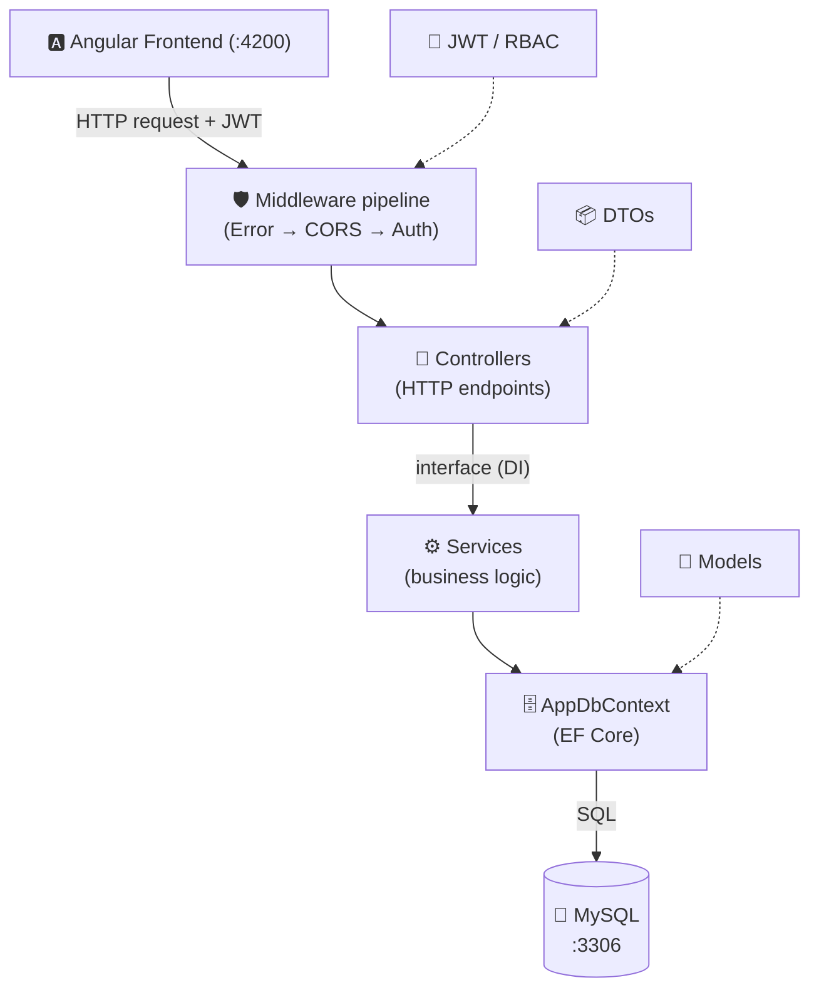

# 🎧 HelpDesk API — ASP.NET Core Ticket Management Backend (Sinhala)

ඕනෑම company / shop / ආයතනයකට apply කරන්න පුළුවන් **Ticket Management System** එකක backend එක.
Customer කෙනෙක් (හෝ employee කෙනෙක්) ප්‍රශ්නයක් **ticket** එකක් විදිහට raise කරනවා → support **agent**ලා
review කරලා, assign කරලා, විසඳනවා.

Database එක **SQLite** (`helpdesk.db` file) — install කරන්න දෙයක් නෑ, data **persist වෙනවා** (restart කරාම යන්නේ නෑ).

---

## ✅ මොනවද තියෙන්නේ

- **Ticket CRUD** — raise, view, update, assign, status මාරු කරන්න
- **Status life-cycle** — Open → InProgress → OnHold → Resolved → Closed → Reopened
- **Priority + SLA** — Low/Medium/High/Urgent; category එකකට SLA පැය; overdue ඉබේම හඳුනනවා
- **Conversation** — public replies + **internal notes** (agents/admin ට විතරක් පේන)
- **Activity history** — ticket එකකට වුණු හැම වෙනසක්ම log (audit trail)
- **Role-based security** — Customer / Agent / Admin (JWT + ownership checks)
- **Categories** — Admin ට manage කරන්න (default priority + SLA එක්ක)
- **User management** — Admin ට accounts හදන්න, role මාරු කරන්න, activate/deactivate
- **Dashboard stats** — counts by status/priority/category, overdue, unassigned, avg resolution
- **Swagger UI** + JWT, global error handling, BCrypt password hashing

---

## 🚀 Run කරන විදිහ

### අවශ්‍ය දේ
- [.NET 8+ SDK](https://dotnet.microsoft.com/download) (.NET 10 තිබුණත් වැඩ — roll-forward)

### පියවර
```bash
cd ProductApi
dotnet restore
dotnet run
```

Browser එකේ: **http://localhost:5000/swagger** 🎉
(පළවෙනි පාර `helpdesk.db` file එක ඉබේම හැදිලා sample data seed වෙනවා.)

---

## 👥 Roles & අවසර

| Role | කරන්න පුළුවන් |
|------|---------------|
| **Customer** | register/login · ticket raise · **තමන්ගේ** ticket බලන්න/comment · resolved ticket reopen |
| **Agent** | ඔක්කොම tickets · filter/search · assign · status/priority මාරු · public reply + internal note |
| **Admin** | Agent ට පුළුවන් සියල්ල + users manage + categories manage + full dashboard |

### Seed කරපු accounts (test වලට)
| username | password | role |
|----------|----------|------|
| `admin` | `admin123` | Admin |
| `nimal` | `nimal123` | Agent |
| `sunil` | `sunil123` | Agent |
| `kamal` | `kamal123` | Customer |
| `amara` | `amara123` | Customer |

---

## 📋 API Endpoints

| Method | Endpoint | Auth | කරන්නේ |
|--------|----------|------|---------|
| POST | `/api/auth/register` | ❌ | අලුත් Customer + token |
| POST | `/api/auth/login` | ❌ | login + token |
| GET | `/api/tickets` | 🔑 | list (filter/search/sort/page; role-scoped) |
| GET | `/api/tickets/{id}` | 🔑 | එක ticket එකක් (full detail) |
| POST | `/api/tickets` | 🔑 | raise |
| PUT | `/api/tickets/{id}` | 🔑 | update |
| PATCH | `/api/tickets/{id}/status` | 🔑 | status මාරුව |
| PATCH | `/api/tickets/{id}/assign` | 🔑 Agent/Admin | assign |
| POST | `/api/tickets/{id}/comments` | 🔑 | reply / internal note |
| GET | `/api/tickets/{id}/history` | 🔑 | activity log |
| GET/POST/PUT/DELETE | `/api/categories` | 🔑 (write=Admin) | categories |
| GET | `/api/users` · `POST` · `PATCH .../role` · `.../active` | 🔑 Admin | user mgmt |
| GET | `/api/users/agents` | 🔑 Agent/Admin | assignment dropdown |
| GET | `/api/dashboard/stats` | 🔑 | role-aware stats |

### Filter query parameters (`GET /api/tickets`)
`status`, `priority`, `categoryId`, `assignedToId` (`-1` = unassigned), `mine=true`,
`search`, `sort` (`newest`|`oldest`|`priority`|`due`), `page`, `pageSize`.

---

## 📂 ව්‍යුහය (layered — Spring Boot වගේ)

```
ProductApi/
├── Program.cs                 # setup: DI + SQLite + JWT + CORS + middleware
├── appsettings.json           # connection string + Jwt + SLA config
├── Models/                    # entities (DB tables)
│   ├── Ticket.cs  User.cs  Category.cs  TicketComment.cs  TicketHistory.cs  Enums.cs
├── DTOs/                      # request/response + validation
├── Data/
│   ├── AppDbContext.cs        # DbSets + relationships + enum→string
│   └── DbSeeder.cs            # sample users/categories/tickets
├── Services/                  # business logic (permission/scoping/SLA/history)
│   ├── TicketService · AuthService · CategoryService · UserService · DashboardService
├── Controllers/               # REST endpoints (+ ApiControllerBase: current user from JWT)
└── Middleware/
    └── ErrorHandlingMiddleware.cs   # exception → 400/403/404/500 JSON
```

**Request එකක ගමන:** `Client → Middleware → JWT auth → role check → Controller → Service → DbContext → Database`

---

## 🧱 ස්ථර (Layered Architecture)

Spring Boot වල `Controller → Service → Repository → Entity` layering එකමයි මෙතනත්.
වෙනස: Repository එක වෙනුවට **EF Core DbContext** එකක් (repository + ORM එකට).



| ස්ථරය | ගොනු | කරන්නේ |
|-------|------|---------|
| **Middleware** | `Middleware/` + `Program.cs` | හැම request එකක්ම මෙතනින් ගලනවා — error handling, CORS, authentication, authorization |
| **Controllers** | `Controllers/` | HTTP endpoints. Request receive → user id/role කියවනවා → Service call |
| **Services** | `Services/` | Business logic — permission checks, scoping, validation, calculations (system එකේ "මොළය") |
| **Data** | `Data/` | EF Core DbContext — LINQ queries → SQL බවට හරවනවා |
| **Models / DTOs** | `Models/`, `DTOs/` | DB entities + request/response shapes (cross-cutting) |

---

## 🔄 Request එකක ගමන (Lifecycle)

උදාහරණය: `POST /api/tickets` (අලුත් ticket එකක් හදනවා) — පියවරෙන් පියවර:

1. **HTTP request පැමිණීම** *(Kestrel web server)* — JSON body + `Authorization: Bearer <token>` header එක එනවා. Kestrel එක receive කරනවා (Tomcat වගේ).
2. **ErrorHandlingMiddleware** — මුළු request එකම `try/catch` එකක් ඇතුළේ wrap වෙනවා. පස්සේ layer එකක exception එකක් ආවොත් මෙතනදී අල්ලලා ලස්සන JSON error එකක් බවට හරවනවා. *(Spring: `@ControllerAdvice`)*
3. **CORS → Authentication → Authorization** *(Program.cs pipeline)* — JWT token එක validate කරලා, claims (user id, role) කියවලා `User` (ClaimsPrincipal) object එකක් හදනවා. `[Authorize]` තියෙනවා නම් login වෙලාද බලනවා.
4. **Routing → Controller method** *(TicketsController.Create)* — URL + verb බලලා route කරනවා. JSON body එක `CreateTicketRequest` DTO එකට **model binding** වෙනවා + `[Required]` validation auto-check වෙනවා.
5. **Current user id + role කියවීම** *(ApiControllerBase)* — `CurrentUserId` + `CurrentRole` JWT claims වලින් කියවනවා (DB lookup ඕන නෑ).
6. **Service call (interface හරහා, DI)** *(ITicketService → TicketService)* — `Program.cs` එකේ register කරපු implementation එක inject වෙලා තියෙනවා. *(Spring: `@Autowired`)*
7. **Business logic + permission/scoping** *(TicketService)* — category check, SLA එකෙන් `DueAt` ගණනය, `TKT-00001` number එක, history entry. අවසර නැත්නම් `UnauthorizedAccessException` throw කරනවා (→ පියවර 2 අල්ලගන්නවා).
8. **Database save** *(AppDbContext → MySQL)* — `_db.Tickets.Add(...); _db.SaveChanges();` — EF Core එක SQL `INSERT` බවට හරවනවා.
9. **DTO → JSON response** — Service එක `TicketDetailResponse` return කරනවා → Controller එක `Ok()` / `CreatedAtAction()` → .NET එක JSON serialize කරලා `200/201` එක්ක ආපහු යවනවා.

---

## 📄 Files එකින් එක විස්තරය (Spring Boot සමානය එක්ක)

### ⚙️ Startup & Configuration

| ගොනුව | කරන්නේ | Spring Boot සමානය |
|-------|---------|-------------------|
| **Program.cs** | Entry point — **මුලින්ම run වෙන file එක** (`main` වගේ). DI register, JWT/CORS/Swagger setup, middleware pipeline, DB seed, `app.Run()` | `Application.java` + `@Configuration` + `SecurityConfig` + `application.properties` |
| **appsettings.json** | Connection string, JWT key/expiry, SLA පැය, logging — config values | `application.properties` / `.yml` |
| **ProductApi.csproj** | NuGet packages + target framework (`net8.0`) | `pom.xml` / `build.gradle` |
| **Properties/launchSettings.json** | Local run profiles — ports, environment | IDE Run Config / `application-dev.properties` |

### 🎯 Controllers — HTTP endpoints

| ගොනුව | කරන්නේ | Spring Boot සමානය |
|-------|---------|-------------------|
| **ApiControllerBase.cs** | සියලු controllers වල parent. JWT claims වලින් `CurrentUserId` + `CurrentRole` දෙනවා, `RequirePermission()` helper | base `@RestController` + `SecurityContextHolder` |
| **AuthController.cs** | register / login / permissions. Login+register public (`[Authorize]` නෑ) | `@PostMapping("/login")` |
| **TicketsController.cs** | tickets list/get/create/update/status/assign/comment/history. ප්‍රධානම controller එක | `@RequestMapping("/api/tickets")` |
| **CategoriesController.cs** | categories — read ඕනම user, write වලට `categories.manage` | `@PreAuthorize(...)` |
| **UsersController.cs** | user management — `users.manage` ඕන | method-level security |
| **RolesController.cs** | dynamic RBAC — roles & permissions manage | role admin controller |
| **DashboardController.cs** | `GET /dashboard/stats` — role-aware | `DashboardController` |

### ⚙️ Services — business logic (interface + implementation)

| ගොනුව | කරන්නේ | Spring Boot සමානය |
|-------|---------|-------------------|
| **I…Service.cs** | interfaces (contracts). Controller inject කරගන්නේ interface එක — `Program.cs` එකේ `AddScoped<IX, X>()` එකෙන් join | `interface` + `@Service` impl |
| **AuthService.cs** | register/login + **BCrypt** hashing + **JWT** generation (claims: id, name, role) | `UserDetailsService` + `JwtService` + `PasswordEncoder` |
| **TicketService.cs** | ticket logic (system එකේ හදවත) — scoping, filter/search/sort/page, status rules, assign rules, SLA, history | `@Service` + `@Transactional` |
| **PermissionService.cs** | RBAC හදවත — `Has(role, perm)` / `Require(...)`. Permissions DB එකේ (වහාම බලපානවා) | `PermissionEvaluator` |
| **RoleService.cs** | roles CRUD + permissions assign. System roles protect, Admin lock | role admin service |
| **UserService.cs** | user CRUD + `GetAgents()` (assign dropdown) | `@Service UserService` |
| **DashboardService.cs** | stats aggregation — counts, trend, breakdowns (role-aware) | reporting service |

### 🗄️ Data — database access

| ගොනුව | කරන්නේ | Spring Boot සමානය |
|-------|---------|-------------------|
| **AppDbContext.cs** | DB door එක. `DbSet<T>` = table, `OnModelCreating` එකේ enums→string, unique indexes, FK relationships + cascade/restrict rules | `EntityManager` + `JpaRepository` + `@Entity` mappings |
| **DbSeeder.cs** | DB හිස් නම් විතරක් sample data (roles, users, categories, tickets + conversation) | `CommandLineRunner` / `data.sql` |

### 🧱 Models — DB entities (`@Entity` වගේ)

| ගොනුව | කරන්නේ |
|-------|---------|
| **User.cs · Ticket.cs · Category.cs** | ප්‍රධාන entities. User — `PasswordHash` (plain නෑ), role, active. Ticket — core: status, priority, FKs, SLA `DueAt`. Category — default priority, SLA hours, soft-delete |
| **TicketComment.cs · TicketHistory.cs** | conversation message (`IsInternal` note) + audit timeline |
| **Role.cs · RolePermission.cs** | dynamic RBAC entities (`User.Role` string = `Role.Name`) |
| **Enums.cs** | `TicketStatus`, `TicketPriority`, `Roles` constants (Java enum වගේ) |
| **Permissions.cs** | permission catalog (fixed) — keys + labels + `IsValid()` |

### 📦 DTOs — request/response shapes

`AuthDtos` · `TicketDtos` · `CategoryDtos` · `UserDtos` · `RoleDtos` · `CommentDtos` · `DashboardDtos`

Entity කෙලින්ම client එකට නොයවා මේවා පාවිච්චි කරනවා — **`PasswordHash` වගේ දේවල් leak නොවෙන්න**, API shape එක stable කරගන්න. Request DTOs වල `[Required]`, `[StringLength]`, `[EmailAddress]` validation attributes තියෙනවා (`[ApiController]` එකෙන් auto-validate).
*(Spring: DTO/record + Bean Validation `@NotNull`, `@Size`, `@Email`)*

### 🛡️ Middleware

| ගොනුව | කරන්නේ | Spring Boot සමානය |
|-------|---------|-------------------|
| **ErrorHandlingMiddleware.cs** | global error handler. Exception වර්ග → HTTP status: `KeyNotFoundException→404`, `UnauthorizedAccessException→403`, `ArgumentException→400`, අනිත්→`500`. හැම controller එකේ try/catch ඕන නෑ | `@ControllerAdvice` + `@ExceptionHandler` |

---

## 🔀 .NET ↔ Spring Boot Cheat-sheet

| මේ project එකේ (.NET 8) | Spring Boot සමානය |
|-------------------------|-------------------|
| `Program.cs` | `Application.java` + `SecurityConfig` + `application.properties` |
| `[ApiController]` class | `@RestController` |
| `[Route("api/x")]` | `@RequestMapping("/api/x")` |
| `[HttpGet] [HttpPost] [HttpPut] [HttpPatch] [HttpDelete]` | `@GetMapping @PostMapping @PutMapping @PatchMapping @DeleteMapping` |
| `[FromBody]` / `[FromQuery]` | `@RequestBody` / `@RequestParam` |
| `interface` + `AddScoped<I,Impl>()` | `interface` + `@Service` bean |
| Constructor injection | `@Autowired` constructor |
| `AppDbContext : DbContext` | `EntityManager` + repositories |
| `DbSet<Ticket>` | `JpaRepository<Ticket, Long>` |
| Model class | `@Entity` |
| `[Required] [StringLength] [EmailAddress]` | `@NotNull @Size @Email` (Bean Validation) |
| `ErrorHandlingMiddleware` | `@ControllerAdvice @ExceptionHandler` |
| `[Authorize]` | `@PreAuthorize` / Spring Security filter |
| `ClaimsPrincipal (User)` / claims | `SecurityContextHolder` / `Authentication` |
| `IConfiguration` / `appsettings.json` | `@Value` / `Environment` / properties |
| LINQ: `_db.Tickets.Where(...)` | JPQL / Criteria / derived queries |
| `_db.SaveChanges()` | `repository.save(...)` / flush |
| `DbSeeder` | `CommandLineRunner` / `data.sql` |
| Middleware pipeline | Servlet `Filter` chain |
| Kestrel | embedded Tomcat |

> **⭐ වැදගත්ම වෙනස්කම් 3ක්:**
> 1. .NET වල Repository වෙනුවට **DbContext** එකක් (EF Core = ORM + repository එකට).
> 2. Annotations වෙනුවට **[Attributes]** (`[HttpGet]` = `@GetMapping`).
> 3. DI එක manual register කරනවා (`Program.cs` එකේ `AddScoped`) — Spring වල `@Service` auto-scan එක වගේ නෙවෙයි.

---

## 💡 Production එකකට ගෙනියන්න

1. **Real DB** — `Program.cs` එකේ `UseSqlite` → `UseNpgsql` (PostgreSQL) / `UseSqlServer`; connection string එක `appsettings.json`.
2. **EF Migrations** — දැන් `EnsureCreated()`. Production එකේ `dotnet ef migrations add Init` → `database update`.
3. **JWT key** — secret එකක (environment variable / secrets manager), source control එකේ නෙවෙයි.
4. **HTTPS** + rate limiting + logging.
5. **Extension ideas** — email notifications, file attachments, SLA escalation jobs, real-time (SignalR).

---

*Frontend එක `../product-ui` (Angular) folder එකේ. මේ project එක Claude සමඟ ගොඩනගන ලදී. 🎉*
